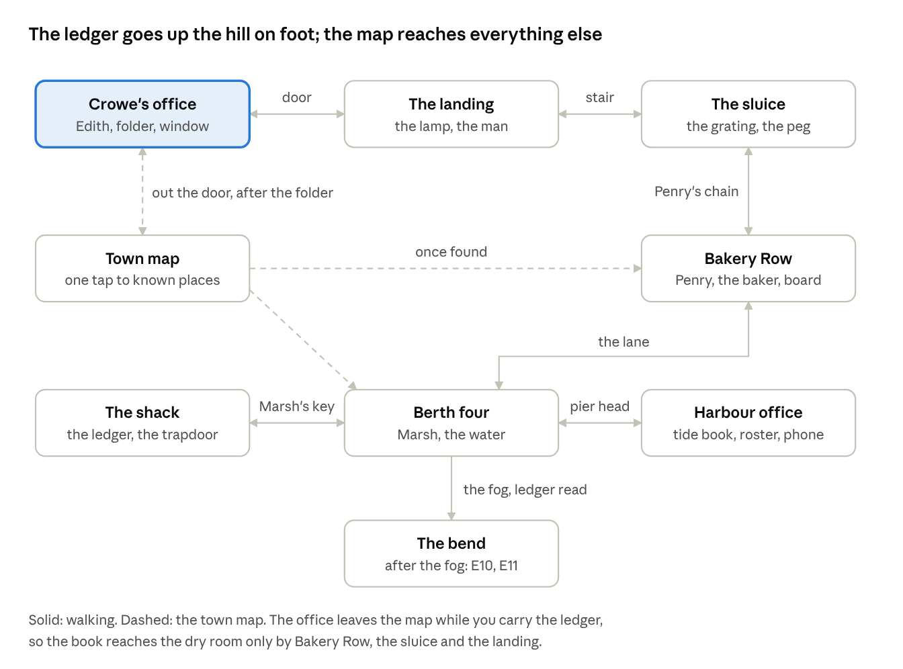
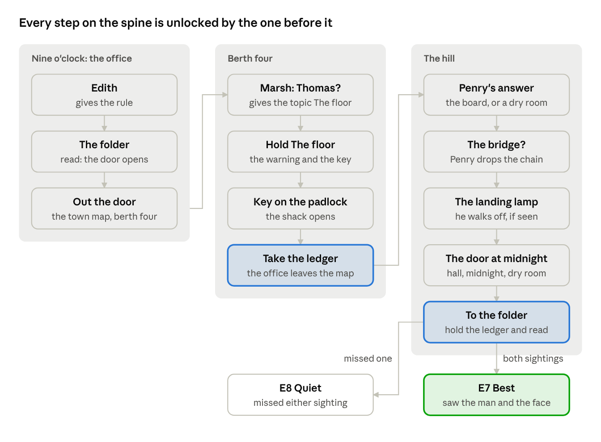

# The Salt Ledger — game design review

Oct 17, 2026 · Igor Chernakov · exported from [the review doc](https://claude.ai/code/artifact/afb590a5-bb7b-4a4b-81b3-7c3364de8e4b)

The Salt Ledger is a one-night supernatural detective case in Grayhaven, 1924, now built the way *The X-Files Game* (1998) is built. You stand in places and turn, question four people with what you carry, travel by a town map, and keep a notebook and a telephone. It is fully playable end to end on generated placeholder pictures and clips: 122 pages, 9 locations, 12 endings. This doc is for reviewing the design before any art is made.

## The case

The reader is Harlan Crowe, a hired detective, and the camera: he is never in frame. Edith Voss hires him to read her drowned brother Thomas's "hour" aloud in Crowe's dry office at midnight, and to leave the trapdoor in the shack at berth four shut.

- **What is really going on.** The hour written in the harbour ledger is a summons. Spoken where the water can hear (the dock, the fog, the sluice, under the streetlamp, at the window, into a telephone) it calls Thomas up. Spoken onto Edith's folder in the dry room, it lets him go.
- **The goal.** Find the ledger in the locked shack, carry it up the hill unread, and read it onto the folder at midnight.
- **The tension.** Every place you need to go offers a wrong mouth for the hour. Most endings are the reader choosing one.
- **Voice.** Second person, present tense, short sentences. Cold, never gory. Owned by `books/salt/DESIGN.md`.

## The model: The X-Files Game

The book copies the shape of *The X-Files Game*, not only its data format. The numbers on the left come from its database, extracted from the CD (`~/Desktop/XFiles_CD1/extracted/index.json`, made by `~/Developer/ai-tools/xfiles-screen.py`).

| | The X-Files Game | The Salt Ledger |
| --- | --- | --- |
| Acts (nodes) | 13, each with 1–3 locations; a global node for the home base; one location per phone call | 3: Nine o'clock (office, town map, calls), Berth four, The hill |
| Locations | 44, of which 18 are places | 9, of which 7 are places |
| Viewpoints per place | 1–50 (Field Office 21, Comity Inn 8) | 1 |
| Facings per viewpoint | about 4.8 | 1–3 |
| Navs per view | about 2.4 (turn left, turn right, step forward) | 1–3 (an edge to turn, an anchor to walk) |
| Explorables per view | about 0.25: most views only move you | about 2: every view has something to look at |
| People per place | 0–5 | 0–2 |
| Travel | the PDA map, to places the case has found | the town map in the notebook |
| Records | notes, email, photos, phone numbers | 7 notes, 2 phone numbers (1924: no email, no camera) |

The play loop is the same. You arrive somewhere with several things in it, and most looks are optional. Some looks open a lead, and you use what you found on people. A person answers once the subject has been found. Progress is gated, never narrated. Travel is one tap once a place is known.

## How a screen works

Every screen is a picture with tappable circles; the book is an fmv book, so prose appears only on documents, and everything else is carried by a clip.

| Screen | What the reader sees | What a tap does |
| --- | --- | --- |
| View | A place, facing one way, with circles on things | A circle on an edge turns you; one on a door or lane walks you; one on a thing plays a look |
| Look (shot) | A close-up clip | Plays, then returns to the view (tap to skip) |
| Document | A page of text with Continue | The folder, the ledger, the tide book, the roster, the tide board, the peg |
| Conversation | The person, lines in a dark band, carried things in a row at the top | A line plays that person's clip; holding a thing shows only what it opens with them, plus the way out |
| Held ledger | The view's circles replaced by places to read the hour | All but one are endings |
| Notebook (Map disc) | Known places, notes, the telephone keypad | Travels, reads a note, or dials; not offered in a conversation |
| Ending | The ending clip and one button | Try again (or Start over after a success) |

Rules kept everywhere: at most six circles for any held state, captions are short noun phrases, and facts only ever turn on.

## The town at a glance

The harbour office and Bakery Row join the map once something names them: the operator, Edith, Marsh, the roster or the lane.

## Places

Seven places, each one spot with one to three facings, plus the town map and the bend in the lane. Circles in *italics* appear only while the ledger is held.

| Place | Facing | Circles |
| --- | --- | --- |
| **Crowe's office** | desk | The folder · The telephone · The lamp · turn to the window · turn to the door |
| | window side | The window · Her chair · turn to the desk |
| | door side | The door (out to the town map, once the folder is read) · Call it a night (E1) · turn to the desk |
| | dry room, midnight | Edith · The window · The door · *To the folder (E7/E8)* · *To the glass (E9)* |
| **Town map** | the plan on the wall | Your office (not while carrying the ledger) · Berth four · The harbour office · Bakery Row (each once found) |
| **Berth four** | the berth | The water · Marsh · The shack · *The padlock (holding the key)* · *To the water (E2)* · turn to the pier head |
| | the pier head | The harbour office · The lane (to Bakery Row) · *To the fog* · turn to the berth |
| | the bend (after the fog) | The hill (E10) · The coat (E11) |
| **The shack** | the table | The ledger (taken) · The trapdoor (E3) · turn to the door |
| | the bare table | The lamp · The trapdoor (E4) · turn to the door |
| | the door | The coat on the hook · Outside · turn to the table |
| **The harbour office** | the counter | The tide book · The telephone · The window · *Into the receiver (E12)* · turn to the wall |
| | the wall | The roster · The pier · turn to the counter |
| **Bakery Row** | up the row | The board · Penry · The bridge (chained until Penry agrees) · turn down the row |
| | down the row | The bakery (the baker) · The lane · turn up the row |
| **The sluice** | the footbridge | The water · The grating · The stair · Bakery Row · *To the water (E5)* |
| **The landing** | the man under the lamp | The lamp · The window · The stair · *To the lamp (E6)* (no door: he stands between you and it) |
| | the empty lamp | The lamp · The window · The door · The stair · *To the lamp (E6)* |

The landing door with the ledger leads through the hall and the midnight clip into the dry room; without it, to the office desk.

## People

Four people talk; Thomas never does. Every line is a clip, and every person either gives a fact the next one needs or opens something that was shut.

| Person | Lines and what unlocks them | Gives |
| --- | --- | --- |
| **Edith Voss**, the client (start) | Your brother? → The floor? · Where will you be? · I'll take the case | The rule, the hotel phone number |
| **Edith** at midnight | The locket (changes if you carry the peg) · He wrote it twice (after the tide book) · *holding* the photograph, the peg or the ledger · Not yet | Hints toward the folder, never the answer for you |
| **Caleb Marsh**, mate of the Patience | Thomas? · *holding The floor*: the warning (then a short repeat) · *holding The coat* · The Patience? · *holding the photograph* · *holding the ledger*: he refuses it | The floor (topic), the brass key, The coat named, A dry room (topic), the harbour office and Bakery Row on the map |
| **Abel Penry**, board-keeper | Thomas? (says where the walker went if Marsh named the coat) · The chalk? (after the board) · *holding A dry room* (same unlock, Marsh's shortcut) · The bridge? (once either answered) · *holding the photograph* · *holding the ledger*: he shuts the door | The chain off the footbridge |
| **Ruth Kell**, baker | Good evening (she pulls the blind) · *holding your card*: what came down the sluice · *holding the photograph* (once she talks) | The grating is worth searching |

The first visit to Marsh and Penry plays an approach clip; later visits go straight to the conversation.

## Carried things and topics

Eight icons in X-Files's five kinds. Inventory and evidence show in the row on views; everything carried shows in conversations, so topics and the card are used only on people.

| Icon | Kind | Comes from | Used on |
| --- | --- | --- | --- |
| Your card | action | carried from the start | the baker: she opens the door |
| Photograph | evidence | the folder | Marsh (points to the harbour office), Penry, the baker, Edith |
| The floor | idea (topic) | Marsh, "Thomas?" | Marsh: the warning and the key |
| The coat | idea (topic) | the office window | Marsh: names the clerk's coat |
| A dry room | idea (topic) | Marsh, "The Patience?" | Penry: drops the chain without the board |
| Brass key | inventory | Marsh, the floor | the shack padlock (used up) |
| Ledger | inventory | the shack table | the mouths; the folder at midnight |
| Peg | evidence | the sluice grating | Edith: changes the locket clip |

No emotion icons yet: X-Files used them for tone in conversation.

## The spine

A reader who skips every optional look still has to pass all twelve steps; the two blue steps are where the hour can first be spent and where it is finally read.

## Optional chains and the best ending

The best ending (E7) needs two optional sightings: the man under the streetlamp from the office window, and the face in the water at berth four. Without either, reading onto the folder is the quiet ending (E8).

- **The window chain.** The office window shows the man and gives *The coat*. Marsh, shown the coat, names a tide clerk's coat. Penry's "Thomas?" then says the man went up to the lamp. At the landing he stands under it, blocking the door, until you approach. The shack's coat on its hook gets a line about its twin.
- **The water chain.** The face between the pilings changes Marsh's "Thomas?" clip to one about the same water under the floor.
- **The bakery chain.** The baker talks only to your card. What she saw puts the peg in the sluice grating. The peg changes Edith's locket clip and the lamp close-up at the landing.
- **The harbour office chain.** The tide book opens Edith's "He wrote it twice". The roster names Penry and puts Bakery Row on the map. Its telephone answers with water, and calling 214 afterwards gets water too.
- **The telephone.** Grayhaven 3071 reaches Edith at the hotel (until the ledger is taken) and points to the harbour office. Grayhaven 214 rings in the empty harbour office.

## Endings

Twelve endings: two successes, one partial, nine failures. Each is a clip; a failure's Try again restores the world as it was at the screen named.

| | Ending | Kind | How you get it | Try again returns to |
| --- | --- | --- | --- | --- |
| E1 | Home | failure | "Call it a night" at the office door | the office door side |
| E2 | The harbour | failure | the ledger read to the water at berth four | berth four |
| E3 | The floor, unread | failure | the shack trapdoor before taking the ledger | the shack table |
| E4 | The floor, read | failure | the shack trapdoor with the ledger | the bare table |
| E5 | The sluice | failure | the ledger read to the sluice | the footbridge |
| E6 | The lamp | failure | the ledger read under the landing lamp | the landing |
| E7 | Best | success | the ledger read onto the folder, having seen the man and the face | start over |
| E8 | Quiet | success | the same, missing either sighting | start over |
| E9 | The glass | failure | the ledger read to the office window at midnight | the dry room |
| E10 | The stair | partial | read to the fog, then climb past him | the pier head |
| E11 | The coat | failure | read to the fog, then go to him | the pier head |
| E12 | The line | failure | the ledger read into the harbour office telephone | the harbour office |

Each is warned first: Edith's and the folder's "not to the water, not in the rain", Marsh's "leave the floor" and "not this fog", Penry's sluice, the man under the lamp, Edith's "not to the glass", and the telephone that has already answered with water.

## State

Twenty-four variables (23 yes/no, one number) plus enable flags for map destinations and notes. Every fact is set in one place and read in another; the book tool's `graph` reports none unused.

| Fact | Set by | Read by |
| --- | --- | --- |
| `read` | the folder | the office door |
| `seen` | the office window | the landing (he is there), the shack coat, the best ending |
| `glimpsed` | the water at berth four | Marsh's Thomas clip, the best ending |
| `asked`, `heard`, `told` | Marsh's answers | which of his lines remain |
| `walker` | Marsh, holding The coat | Penry's Thomas clip |
| `open` | the padlock | entering the shack |
| `tide` | the tide book | Edith's "He wrote it twice" |
| `rang` | the harbour office telephone | the 214 call |
| `board` | the tide board | Penry's "The chalk?" |
| `sight` | the baker, with the card | the grating |
| `named`, `warned` | Penry, "Thomas?" | his line goes; the lamp clip |
| `penry`, `chain` | Penry's chalk or dry-room answer, then the bridge | the footbridge |
| `left` | the man under the lamp walks off | the landing door |
| `midnight` | the midnight clip | a call from the office returns to the dry room |
| `here` (number) | entering each place | a phone call returns to where you dialled from |
| `met`, `met-penry`, Edith's three | first approaches and lines | which clips and lines replay |

## Placeholders, production and playtesting

Every picture and clip is a generated placeholder, so the structure can be played and judged before anything is painted or filmed: 46 stills, 73 clips, 8 icons.

- **Stills** are a solid colour per location, with the camera's name, a one-line art brief, and a labelled mark where each circle will sit.
- **Clips** show the clip's name and the full text that clip must deliver, held long enough to read, with a bar filling along the bottom. Since an fmv book shows no prose on shots, replies or endings, the clip is where the playtester reads the story.
- **Generating.** `make placeholders BOOK=salt` writes them all. Each is stamped and redrawn only when its page, brief or anchors change. Placeholders nothing names any more are deleted. Finished art is never overwritten.
- **Replacing.** Paint `illustrations/<camera>.png`, or drop a finished JPEG or MP4 at the placeholder's path. `build/cli/book assets salt` lists every asset as painting, render, present, placeholder or missing, with the prose each one must show.
- **Briefs and circle positions** live in `books/salt/rooms/grayhaven.blks`: one camera per picture, anchors on a plane in front of it.
- **Old art.** The earlier photographic plates and the 25 filmed clips are kept in `books/salt/legacy/` for reuse.

**To playtest:** `make run` opens the Mac app. `build/cli/book play salt <steps>` prints a transcript. `books/salt/WALKTHROUGH.md` gives the routes to every ending. `make check` plays all twelve endings, the map, the phone and every gate automatically. The full screen list is `books/salt/GDD.md`.

## Open questions for review

Decisions taken in this pass that deserve a yes or a change. Tick one off when it is settled.

- [ ] **Walking inside places.** X-Files places have many spots to walk between (Comity Inn: 8). Ours have one spot each with up to three facings. Add a second spot to the bigger places (berth four, Bakery Row), or keep them compact?
- [ ] **Acts that change nothing.** The three acts only group locations. In X-Files an act moves time on and changes what is open. Should taking the ledger start a "Midnight" act that closes the harbour office and moves people?
- [ ] **The hill is open early.** Bakery Row, the sluice and the landing can be visited before the ledger. Fine for exploring, or should the lane stay closed until the book is carried?
- [ ] **Call it a night (E1).** An instant failure behind an ordinary-looking circle in the office. Keep, add a warning look first, or cut E1?
- [ ] **Two keys to Penry.** The tide board or Marsh's "a dry room" both open the chain. Is the shortcut too easy, or is two routes the point?
- [ ] **The card is used once.** Only the baker needs it. Use it on a second person (a night watchman at the harbour office?), or make it a one-off?
- [ ] **Tone.** No emotion icons yet. X-Files let you choose a tone in conversation; worth adding for Marsh or Edith?
- [ ] **Thomas never talks.** Should the man under the lamp be a short conversation (one line, one look) instead of a single clip?
- [ ] **Clip budget.** 73 clips to film. Which looks could stay stills with a caption instead (the lamp glass, the chair, the padlock)? An fmv book shows no captions today, so that would need an engine change.
- [ ] **Exit lines.** The engine needs a way out of a conversation for every icon the reader might be holding, so each person has eight near-identical "That's all" lines in the XML. Change the engine to fall back to the plain exit?
- [ ] **Phone returns.** A call returns to the place's main view, not the exact facing you dialled from. Acceptable?
- [ ] **UI check.** `make check-ui` fails on Salt because the opening shot has no button for the test to press. This predates the restructure; fix the test or the opening?
