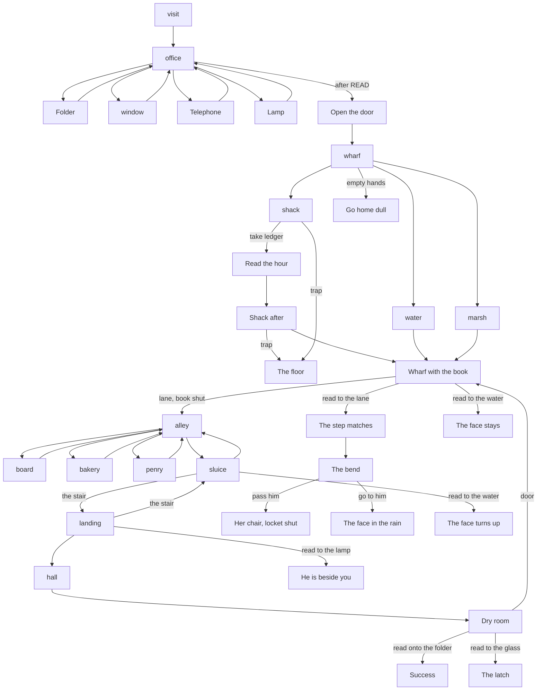

# Map

Grayhaven is the office, the harbor, and three screens between the pier and
the office door. The office looks down a rainy street. The street ends at
berth four. The shack sits on that dock, over the water. Going back up the
lane with the book shut is the alley, the sluice, and the landing. The fog
is not a place of its own. It is what the lane does if the hour is read there.

This is a picture book, so an exit is a choice on an anchor. One-way beats
are close-ups: one Continue, then the hub.

| Place | Camera | Circles | Where they go | Special |
|---|---|---|---|---|
| Office, Edith present | visit | Continue | Office | Opening. Clip: Edith. |
| Office | office | Folder, window, telephone, lamp, door | Close-ups, then back. The door goes to the wharf | Door only after the folder. |
| Wharf | wharf | Water, mate, shack, lane | Face or a second look, Marsh, shack, or the dull ending | No ledger yet. |
| Wharf, book carried | wharf | Same four. Held: water, fog, lane, mate | Harbor, the bend, the alley, Marsh's refusal | The shack is not offered while the book is open. |
| Marsh | marsh | Thomas, the floor, the Patience, the dock. Held: the hour | Answers, then back. The dock returns to the wharf | First visit plays his clip. The floor sets HEARD. |
| Shack | shack | Ledger, coat, trap, door | The open book, a close-up, the floor, the wharf | The ledger is taken here. |
| Shack, book taken | shack-bare | Coat, trap, door | Close-up, the floor, the wharf | No reading circle. |
| Alley | alley | Board, window, man, bridge | Board, bakery, Penry, the sluice | No reading circle. |
| Penry | penry | Lines: Thomas, the chalk, the bridge, That's all. Held: That's all | Reply clips, then back | The chalk waits on the board and sets PENRY. The bridge waits on that. A line leaves once answered. |
| Sluice | sluice | Water, grating, stair, alley. Held: water, stair, alley | A look, the peg, the landing, the alley | PENRY changes the arrival. Reading the water ends the night. |
| Landing | landing | Lamp, window, door, stair. Held: lamp, door, stair | Him leaving or a still, a window, the hall, the sluice | SEEN puts him under the lamp until he walks off. PEG changes the empty lamp. |
| Hall | hall | Continue | The dry room | One still. Green light under the office door. |
| Dry room | visit | Folder, locket, window, door. Held: folder, glass, door | Remind, locket, the glass, or back to the wharf | Edith is in the chair. The folder, book open, wins. |
| Bend | corner | The hill, the coat | Her chair with the locket shut, or his face | Only after the hour was read to the fog. No reading circle. |

Hubs: the office, the wharf, Marsh, the shack, the alley, Penry, the sluice,
the landing, and the dry room. The lane with the book shut is the threshold
into the last choice. Reading the hour on the dock, to the sluice, or under
the lamp does not finish the walk. It spends the hour.

No room is a dead end. The dry room's door goes back down to the wharf. The
folder, before it is read aloud, tells you to open the ledger. The alley and
the sluice walk both ways.
