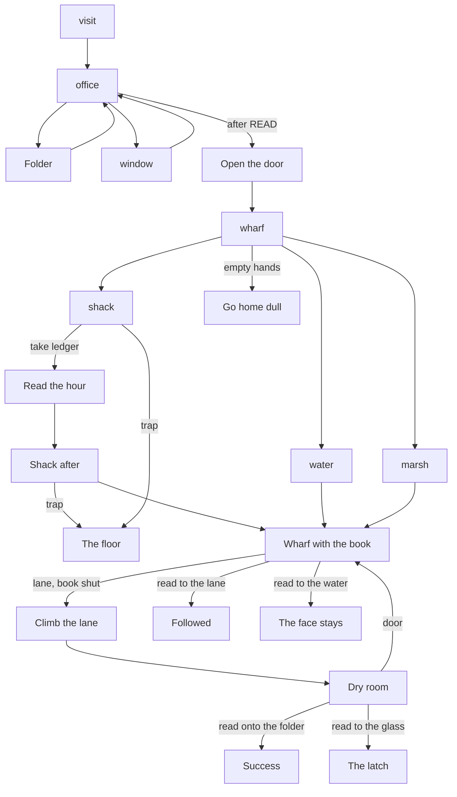

# Map

Grayhaven is three places. The office looks down a rainy street. The street ends at berth four. The shack sits on that dock, over the water. Going back up the lane is the way to the office. The fog is not a fourth place; it is what the lane does if the hour is read there.

This is a picture book, so an "exit" is a choice on an anchor, not a compass direction. One-way beats are marked.

| Place | Camera | Choices | Where they go | Special |
|---|---|---|---|---|
| Office, Edith present | visit | Continue | Office, she has gone | Opening. Clip: both of them. |
| Office | office | Folder, window, door | File, window beat, door beat | Door only after the folder is read. |
| Office, folder | office-file | Continue | Office | Sets READ. |
| Office, window | window | Continue | Office | Sets SEEN. Clip: Crowe at the glass. |
| Office door | office | Continue | Wharf | Clip: he opens the door. |
| Wharf | wharf | Water, mate, shack, lane | See checks | No ledger yet. Lane with empty hands ends the night. |
| Wharf, book carried | wharf | Same four, plus read-to-water and read-to-lane while the ledger is held | Harbor, Marsh, shack, office climb, or a wrong reading | The lane with the book shut climbs home. |
| Water | water | Continue | Back to the wharf page that matches the coat | Sets GLIMPSED the first time. |
| Patience | marsh | Continue | Same | Sets HEARD the first time. With the book, he refuses it. |
| Shack | shack | Ledger, trap, door | Ledger page, the floor, wharf | Ledger is taken here. |
| Shack, book taken | shack-bare | Trap, door | The floor, wharf with the book | |
| Lane, book shut | street | Continue | Office, the dry room | Not an ending. The fog lets him pass. |
| Office, returned | office | Folder, window, door | Remind, look, back to the wharf | While the ledger is held: folder wins, window calls him. |

Hubs: the office, the wharf, the shack. The loop is office to wharf to shack and back up the lane. The lane with the book shut is the threshold into the last choice. Reading the hour on the dock does not climb; it spends the hour.

No room is a dead end. The door at the dry room goes back down to the wharf. The folder, before it is read aloud, tells you to open the ledger.
